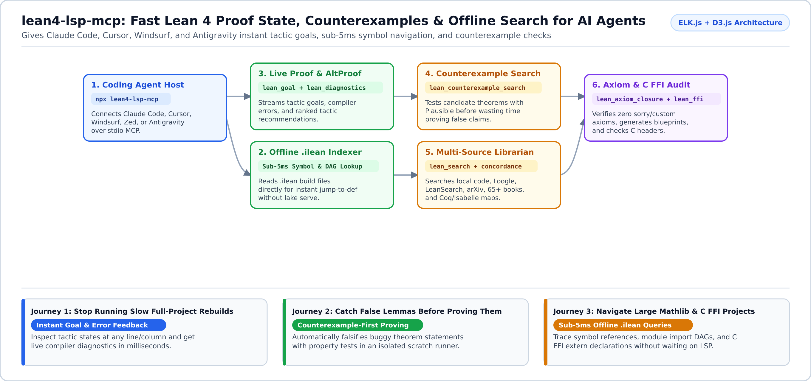
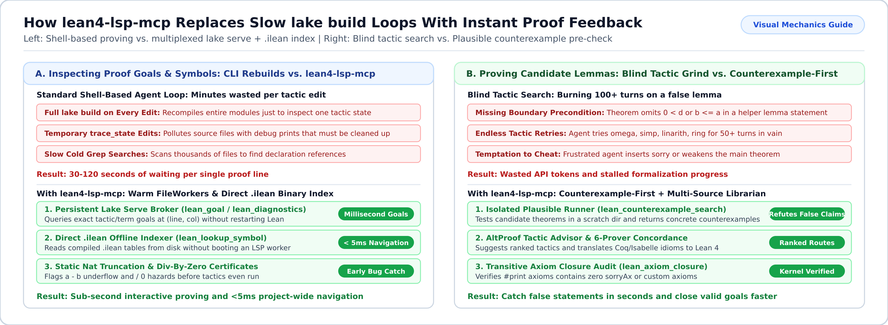

# `lean4-lsp-mcp`

**Give AI coding agents instant Lean 4 proof goals, sub-5ms symbol navigation, and automatic counterexample checks without waiting on full project rebuilds.**

`lean4-lsp-mcp` (published on npm as `lean4-lsp-mcp` / `lean-lsp-mcp`) is a standalone *Model Context Protocol (MCP)*[^mcp] server that connects AI coding agents (Claude Code, Cursor, Windsurf, Zed, and Antigravity) directly to your Lean 4 proof environment and C FFI headers.



---

## Why Use `lean4-lsp-mcp`? (What Problem Does It Solve?)

When AI coding agents try to write or fix Lean 4 proofs using standard shell commands, they get stuck in a slow, expensive loop:

1. **Running `lake build` after every edit takes minutes**: Standard agents edit a `.lean` file, insert `trace_state`, and recompile the whole module just to see the current proof goal. `lean4-lsp-mcp` keeps a shared `lake serve` session warm and returns the exact tactic goal at any line and column in milliseconds (`lean_goal`).
2. **Agents waste hours trying to prove false lemmas**: If a helper lemma has a subtle boundary bug (like a natural number subtraction underflow), an agent will burn hundreds of tactic attempts trying to prove the impossible. `lean_counterexample_search` tests candidate theorems with *Plausible*[^plausible] first so false claims are caught in seconds.
3. **Searching large Mathlib or multi-file projects is slow**: Starting a full language server just to find where a theorem is defined or used eats RAM and time. `lean4-lsp-mcp` reads compiled `.ilean` index files directly from disk in **under 5 milliseconds** (`lean_lookup_symbol`, `lean_decl_references`, `lean_module_hierarchy`).

---

## Start in 2 Minutes

### 1. Run via `npx` (Zero Manual Build Required)

Add `lean-lsp` to your coding agent's MCP configuration (`.mcp.json`, `~/.claude/claude_desktop_config.json`, or `.cursor/mcp.json`):

```json
{
  "mcpServers": {
    "lean-lsp": {
      "command": "npx",
      "args": ["-y", "lean4-lsp-mcp"],
      "env": {
        "PATH": "${HOME}/.elan/bin:/usr/bin:/bin"
      }
    }
  }
}
```

<details>
<summary><b>Alternative: Install globally or build from source</b></summary>

```bash
# Global npm install
npm install -g lean4-lsp-mcp

# Or build from a local clone
git clone https://github.com/r-irbe/lean4-lsp-mcp.git
cd lean4-lsp-mcp && npm install && npm run build
```

If your IDE launches MCP servers from outside your Lean repository, set `"LEAN_PROJECT_ROOT": "/path/to/your/lake/project"` in the `env` block.
</details>

---

## Adapt to Your Use Case (Customer Journeys)



<details open>
<summary><b>1. Interactive Theorem Proving -- Inspect Goals & Fix Errors Without Rebuilding</b></summary>

- **Who this is for**: Researchers, engineers, and AI agents actively closing `sorry` placeholders in Lean 4.
- **How to use it**:
  - Call `lean_goal` with `{"filePath": "MyProj/Basic.lean", "line": 42, "col": 4, "target": "tactic"}` to see the exact proof state at the cursor, or `"target": "altproof"` for ranked tactic suggestions.
  - Call `lean_diagnostics` with `{"filePath": "MyProj/Basic.lean"}` to get live compiler errors plus automatic warnings for natural-number truncation (`a - b` without `b <= a`) and division by zero.
</details>

<details>
<summary><b>2. Counterexample-First Proving -- Test a Claim Before Spending Proof Budget</b></summary>

- **Who this is for**: Teams writing new formal specifications where edge cases (`0`, empty lists, off-by-one bounds) are easy to miss.
- **How to use it**: Call `lean_counterexample_search` with `{"filePath": "MyProj/Spec.lean", "theoremName": "my_lemma", "strategy": "dense"}`. It runs an isolated property check in a scratch directory and returns a concrete counterexample if the lemma is false.
</details>

<details>
<summary><b>3. Large-Corpus Navigation, Cross-Prover Porting & C FFI Audits</b></summary>

- **Who this is for**: Maintainers of large Lean 4 repositories, teams porting proofs from Rocq/Coq or Isabelle, and systems engineers binding Lean 4 `@[extern]` functions to C.
- **How to use it**:
  - **Sub-5ms Offline Navigation**: `lean_lookup_symbol`, `lean_decl_references`, and `lean_module_hierarchy` query `.lake/build/lib/**/*.ilean` directly without booting `lake serve`.
  - **Multi-Source Search**: `lean_search`, `lean_book_index_lookup` (65+ math/CS textbooks), and `lean_cross_itp_concordance` (Coq/Isabelle/HOL Light -> Lean 4 tactic equivalents).
  - **Trust & FFI Verification**: `lean_axiom_closure` verifies a theorem depends only on standard axioms (`propext`, `Classical.choice`, `Quot.sound`), and `lean_ffi` checks `@[extern]` C symbols against your C headers.
</details>

---

## Complete 21-Tool Reference

See [`instructions.md`](./instructions.md) for copy-paste JSON payloads and agent prompting guidelines.

<details>
<summary><b>View all 21 MCP tools and parameters</b></summary>

| Tool Name | Required Parameters | What It Does |
| :--- | :--- | :--- |
| `lean_goal` | `filePath`, `line` | Returns tactic goal, term goal, filtered goal, or `altproof` tactic advice at `(line, col)`. |
| `lean_diagnostics` | `filePath` | Live elaboration errors, unsolved goals, and static `Nat` truncation/div-by-zero checks. |
| `lean_counterexample_search` | `filePath`, `theoremName` | Runs Plausible property testing in an isolated scratch dir to falsify broken theorems. |
| `lean_lookup_symbol` | `symbol` | Instant offline `.ilean` jump-to-definition and type signature lookup (<5ms). |
| `lean_decl_references` | `symbol` | Finds declarations that `uses` or are `usedBy` the target symbol (<5ms). |
| `lean_module_hierarchy` | `moduleName` | Returns module `imports` or `importedBy` dependency trees. |
| `lean_dependency_subgraph` | `moduleName` | Exports bounded module dependency subgraphs (`mermaid`, `dot`, or `json`). |
| `lean_search` | `query` | Unified search across local code, Loogle, LeanSearch, Reservoir, arXiv, books, and graph. |
| `lean_book_index_lookup` | `term` | Looks up concepts across 65+ curated theorem-proving and math textbook indexes. |
| `lean_cross_itp_concordance` | `concept` | Maps tactics and concepts across Coq/Rocq, Isabelle, HOL Light, Agda, and Lean 4. |
| `lean_axiom_closure` | `symbol` | Runs `#print axioms` to verify a theorem uses no `sorryAx` or custom axioms. |
| `lean_metrics` / `lean_module_census` | `target` | Computes declaration counts, complexity metrics, and corpus censuses. |
| `lean_blueprint` / `lean_blueprint_scaffold` | *(optional)* | Scaffolds and inspects Lean Blueprint LaTeX/dependency nodes and Zettelkasten links. |
| `lean_proof_skeleton` | `filePath` or `symbol` | Extracts the high-level `have`/`suffices` skeleton of a proof. |
| `lean_ffi` | *(optional)* | Inspects Lean C FFI sysroot headers and verifies `@[extern]` C symbol bindings. |
| `lean_exec` / `lean_run_code` | `code` | Executes a standalone Lean 4 snippet (`#check`, `#eval`) via `lake env lean`. |
| `lean_resync` / `lean_server_status` | `filePath` / *(none)* | Refreshes a file worker or reports the resolved Lake project root and server health. |
</details>

[^mcp]: **Model Context Protocol (MCP)**: An open standard that lets AI coding assistants call external tools and language servers over stdio JSON-RPC.
[^plausible]: **Plausible**: Lean 4's property-based testing library (similar to QuickCheck) that generates test inputs to find counterexamples to a theorem statement.
